# ai-dev — AI Dev Orchestrator

`ai-dev` es una CLI en Go que acompaña un proceso de desarrollo guiado por especificaciones (Spec-Driven Development, SDD) con agentes de programación (Claude Code y Codex CLI), **sin quitarle nunca la autoridad al humano**. Diagnostica el entorno, ejecuta agentes de forma explícita, selecciona el agente adecuado para cada rol, lleva el estado del ciclo de vida de cada feature, registra decisiones humanas (Human Gates) y gestiona la inicialización supervisada de repositorios Git.

El principio que atraviesa todo el diseño:

> `agent_succeeded` ≠ transición de workflow ≠ aprobación humana

Que un agente termine con éxito, que exista un artefacto o que una transición sea válida **nunca** autoriza nada por sí solo. Toda mutación de estado o de repositorio exige una decisión humana explícita y verificable.

---

## Índice

1. [Estado actual](#estado-actual)
2. [Instalación y requisitos](#instalación-y-requisitos)
3. [Referencia de comandos](#referencia-de-comandos)
4. [Arquitectura](#arquitectura)
5. [Features](#features)
   - [001 · Environment Doctor](#001--environment-doctor)
   - [002 · Coding Agent Execution](#002--coding-agent-execution)
   - [003 · Agent Role Selection](#003--agent-role-selection)
   - [004 · Workflow State](#004--workflow-state)
   - [005 · SDD Workflow](#005--sdd-workflow)
   - [006 · Human Gates](#006--human-gates)
   - [008 · Git Management](#008--git-management)
6. [Modelo de seguridad](#modelo-de-seguridad)
7. [Persistencia](#persistencia)
8. [Desarrollo y calidad](#desarrollo-y-calidad)
9. [Proceso de ingeniería](#proceso-de-ingeniería)
10. [Limitaciones conocidas](#limitaciones-conocidas)

---

## Estado actual

| Feature | Comando(s) | Estado |
|---|---|---|
| 001 Environment Doctor | `ai-dev doctor` | Implementada |
| 002 Coding Agent Execution | `ai-dev agents`, `ai-dev agent run` | Implementada |
| 003 Agent Role Selection | `ai-dev agent select` | Implementada |
| 004 Workflow State | `ai-dev workflow state`, `ai-dev workflow transition` | Implementada |
| 005 SDD Workflow | `ai-dev workflow next` | Implementada (solo lectura) |
| 006 Human Gates | `ai-dev workflow approve`, `ai-dev workflow abandon` | Implementada |
| 007 Interactive CLI | — | No incluida en este repositorio |
| 008 Git Management | `ai-dev init …`, `ai-dev git commit validate` | Implementada, revisada de forma independiente y con evidencia en macOS/APFS y Linux/ext4 (VM); pendiente T132 (Git 2.45) |

Cada feature tiene su especificación, plan, contratos, modelo de datos y tareas en [`specs/`](specs/).

---

## Instalación y requisitos

- **Go 1.27.1** (ver [`go.mod`](go.mod)). El módulo no tiene dependencias externas: solo la biblioteca estándar.
- **Plataformas:** macOS y Linux. Las operaciones con estado duradero fallan de forma cerrada (`platform_unsupported`) en Windows, iOS y Android.
- **Git ≥ 2.45** para Git Management (usa `init --ref-format` y `config --end-of-options`).
- Opcionales, según lo que se use: `specify` (Spec Kit), `claude` (Claude Code), `codex` (Codex CLI).

```sh
go build -o ai-dev ./cmd/ai-dev
./ai-dev doctor
```

---

## Referencia de comandos

Todos los comandos aceptan `--format text|json`. El texto es para humanos; el JSON es estable y está pensado para automatización.

| Comando | Qué hace | ¿Muta algo? |
|---|---|---|
| `ai-dev doctor` | Diagnostica si el entorno y el repositorio están listos | No |
| `ai-dev agents` | Lista los agentes soportados y su disponibilidad local | No |
| `ai-dev agent run <agent-id> [instruction]` | Ejecuta un agente con una instrucción (argumento o stdin) | Lo que haga el agente, bajo su propio sandbox |
| `ai-dev agent select <role>` | Indica qué agente corresponde a un rol | No |
| `ai-dev workflow state <feature-id>` | Informa del estado actual de una feature | No |
| `ai-dev workflow transition <feature-id> <target>` | Evalúa si una transición es válida | No |
| `ai-dev workflow next <feature-id>` | Recomienda el siguiente paso SDD | No |
| `ai-dev workflow approve --approver ID [--reason T] <feature-id> <target>` | Registra una aprobación humana y aplica la transición | Sí: `workflow-state.json` |
| `ai-dev workflow abandon --approver ID --reason T <feature-id> abandoned` | Registra un abandono humano | Sí: `workflow-state.json` |
| `ai-dev init [--project-dir PATH]` | Asistente interactivo de Git (requiere TTY) | Solo tras confirmar el digest del plan |
| `ai-dev init inspect` | Inspecciona el proyecto y su repositorio | No |
| `ai-dev init plan … --output FILE` | Genera un plan determinista y lo escribe fuera del proyecto | Solo el archivo del plan |
| `ai-dev init apply --plan FILE --confirm-plan sha256:… --authorization-id UUID …` | Emite o consume una autorización y aplica el plan | Sí: repositorio y configuración |
| `ai-dev init reconcile --plan FILE --authorization-id UUID` | Informe de reconciliación de un intento interrumpido | No |
| `ai-dev git commit validate (--message T \| --file F)` | Valida un mensaje Conventional Commits | No |

**Códigos de salida (uniformes):**

| Código | Significado |
|---|---|
| `0` | Resultado positivo: listo, éxito del agente, transición válida, `applied` o `already_applied` |
| `1` | Resultado negativo del dominio: no listo, refusal, fallo del agente, estado indeterminado |
| `2` | Uso incorrecto o fallo interno antes de evaluar |

---

## Arquitectura

### Contexto del sistema

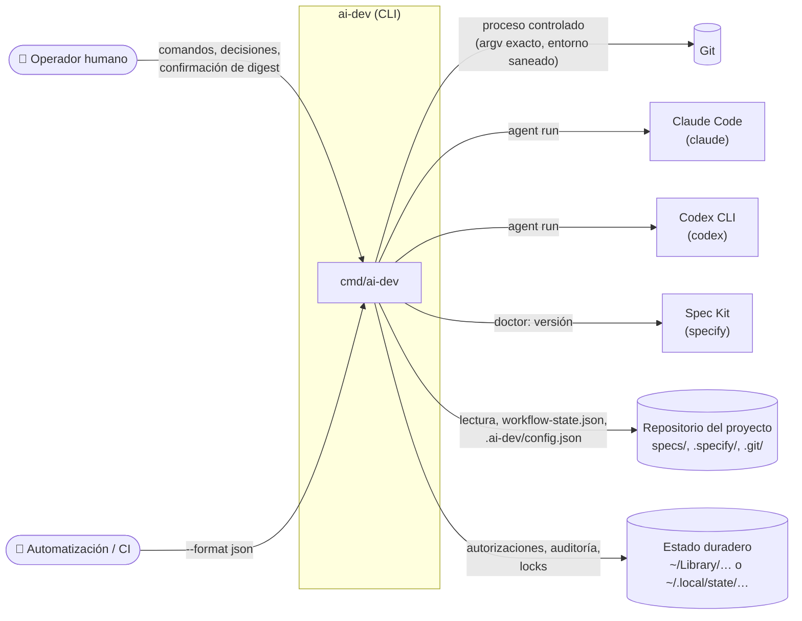

### Capas y dependencias entre paquetes

La arquitectura es hexagonal: los paquetes de dominio no conocen procesos, terminales ni sistemas de archivos concretos. Los adaptadores implementan puertos definidos por el dominio y `internal/app` es la *composition root*.

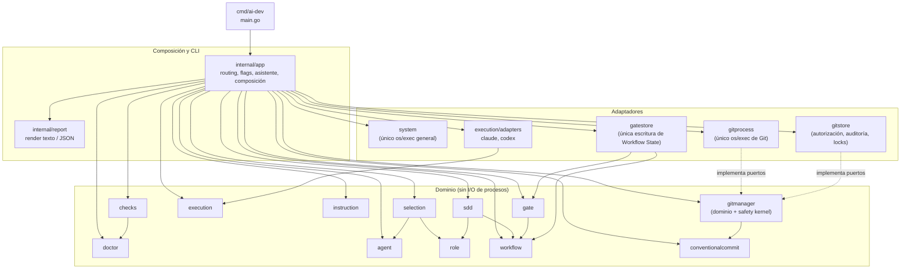

Pruebas estructurales en el propio repositorio hacen cumplir estas fronteras:
- `gitmanager` solo importa la biblioteca estándar y `conventionalcommit`.
- `os/exec` está prohibido fuera de `gitprocess` (para Git) y `system`.
- Git Management no importa `workflow`, `gate`, `gatestore`, `role`, `selection`, `agent` ni `execution`: no puede conceder autoridad de Workflow ni de Human Gate.
- Ningún archivo de producción fuera de `safety.go` puede construir un `MutationPermit`.

### Estructura del repositorio

```text
cmd/ai-dev/              punto de entrada y pruebas end-to-end por subproceso
internal/
  app/                   composición, routing de comandos, asistente interactivo
  report/                renderizado texto/JSON de todos los informes
  doctor/ checks/        001 — modelo de readiness y los nueve checks
  agent/ execution/      002 — catálogo de agentes y modelo de ejecución
    execution/adapters/        adaptadores claude/codex
  instruction/           002 — fuente de la instrucción (argumento o stdin)
  role/ selection/       003 — roles y política rol → agente
  workflow/              004 — estados, reglas de transición, registro
  sdd/                   005 — recomendación del siguiente paso
  gate/ gatestore/       006 — decisiones humanas y su persistencia atómica
  gitmanager/            008 — dominio Git, planificación, safety kernel
  gitprocess/            008 — adaptador del proceso Git
  gitstore/              008 — almacén duradero de autorizaciones y auditoría
  conventionalcommit/    008 — validador Conventional Commits independiente
  system/                frontera de procesos externos y lanzador de agentes
specs/NNN-*/             spec, plan, contratos, data model, tareas por feature
.specify/                configuración de Spec Kit y constitución del proyecto
```

---

## Features

### 001 · Environment Doctor

`ai-dev doctor` ejecuta **nueve checks independientes**, siempre en el mismo orden. Que uno falle no impide que se ejecuten los demás; cada fallo explica qué falta y cómo remediarlo.

| # | ID | Área | Comprueba |
|---|---|---|---|
| 1 | `git-tool` | Environment | `git` instalado y ejecutable |
| 2 | `speckit-tool` | Environment | `specify` instalado |
| 3 | `claude-code-tool` | Environment | `claude` instalado |
| 4 | `codex-cli-tool` | Environment | `codex` instalado |
| 5 | `git-repository` | Repository | El directorio actual es un repositorio Git |
| 6 | `speckit-initialized` | Repository | `.specify/integrations/speckit.manifest.json` válido |
| 7 | `constitution` | Repository | `.specify/memory/constitution.md` completo (sin placeholders, con Version y Ratified) |
| 8 | `claude-integration` | Repository | Integración Spec Kit de Claude instalada |
| 9 | `codex-integration` | Repository | Integración Spec Kit de Codex instalada |

```mermaid
flowchart LR
    start(["ai-dev doctor"]) --> run["RunAll: 9 checks<br/>aislados entre sí"]
    run --> c1["Environment<br/>git · specify · claude · codex"]
    run --> c2["Repository<br/>repo · Spec Kit · constitución · integraciones"]
    c1 & c2 --> agg{"¿Todos pass?"}
    agg -- sí --> ok["Overall: pass<br/>exit 0"]
    agg -- no --> ko["Overall: fail<br/>exit 1 + remediación por check"]
```

La detección de autenticación de Claude y Codex queda **fuera de alcance** a propósito: no se infiere.

### 002 · Coding Agent Execution

Es una abstracción neutral respecto al proveedor para descubrir e invocar agentes. Hoy soporta `claude-code` y `codex-cli`, y se pueden añadir otros sin cambiar el modelo de ejecución.

| Agente | Ejecutable | Invocación |
|---|---|---|
| `claude-code` | `claude` | `claude --print <instruction>` |
| `codex-cli` | `codex` | `codex exec <instruction>` |

La instrucción llega como argumento **o** por stdin no interactivo, nunca por ambos a la vez. `ai-dev` no eleva permisos ni salta el sandbox o las aprobaciones del agente.

El resultado distingue tres outcomes:
- `agent_succeeded`: el agente terminó con éxito.
- `agent_failed`: el agente se ejecutó y terminó con un resultado no exitoso.
- `execution_failed`: `ai-dev` no pudo lanzarlo o supervisarlo.

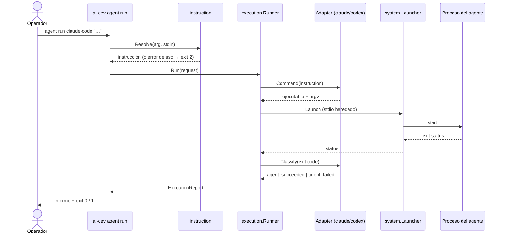

### 003 · Agent Role Selection

Dado un rol de desarrollo explícito, determina qué agente usar e informa de ello. La selección es determinista y de solo lectura: **no ejecuta, lanza, autentica ni reconfigura ningún agente**. La tabla es código, no datos, así que no se puede modificar en tiempo de ejecución.

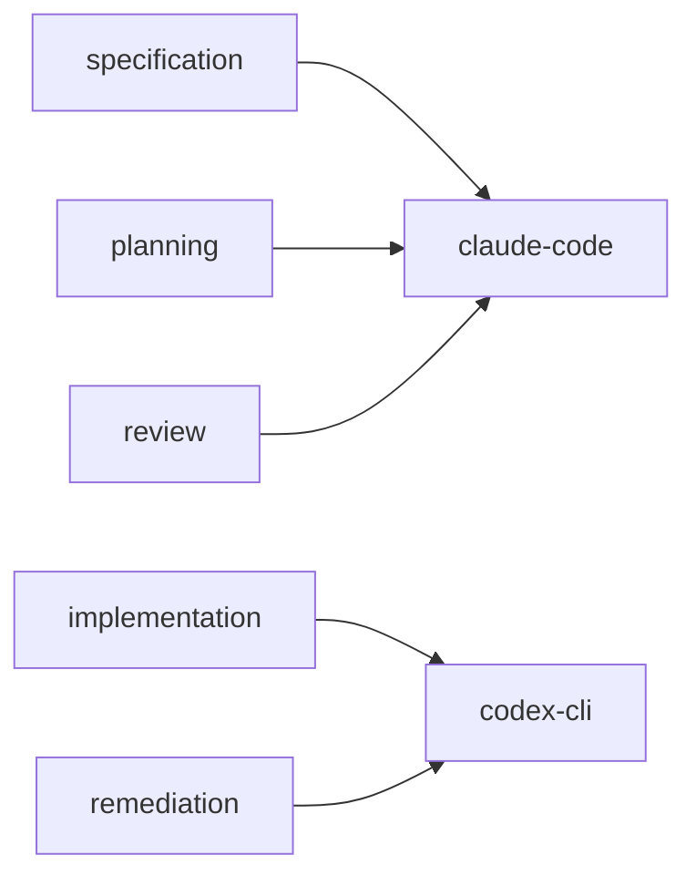

Outcomes posibles:
- `role_selected`: el rol es válido y su agente está disponible.
- `role_unsupported`: el rol no es uno de los cinco canónicos.
- `agent_unavailable`: el agente que corresponde al rol no está disponible localmente.
- `selection_inconsistent`: el resultado no supera la validación contra la política fija.

### 004 · Workflow State

Representa el estado del ciclo de vida de una feature. El registro vive en `specs/<feature-id>/workflow-state.json`; si no existe, el estado es `draft`. Los comandos `state` y `transition` **solo leen**: `transition` evalúa si un cambio es válido, pero no lo aplica.

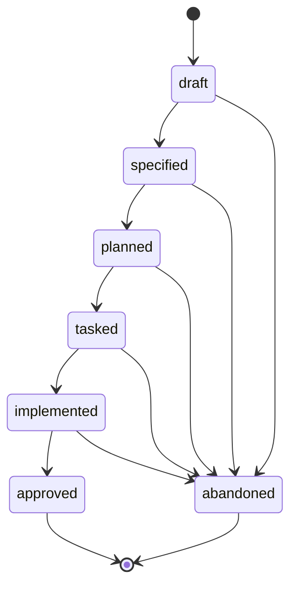

`approved` y `abandoned` son terminales.

Outcomes posibles:
- `state_reported`: se informó el estado actual.
- `feature_unknown`: la feature no existe.
- `state_invalid`: el registro de estado no es válido.
- `transition_valid` y `transition_invalid`: la transición pedida está o no permitida por las reglas.
- `target_unsupported`: el estado destino no es uno de los canónicos.

### 005 · SDD Workflow

`ai-dev workflow next` conecta el estado (004), los roles (003) y los artefactos de Spec Kit para **recomendar** el siguiente paso. Solo recomienda: separa "qué debería pasar después" de "autorizar que pase". No ejecuta agentes ni persiste nada.

| Estado actual | Actividad recomendada | Rol | Artefactos requeridos |
|---|---|---|---|
| `draft` | specify | specification | — |
| `specified` | plan | planning | `spec.md` |
| `planned` | tasks | planning | `spec.md`, `plan.md` |
| `tasked` | implement | implementation | `spec.md`, `plan.md`, `tasks.md` |
| `implemented` | review | review | `spec.md`, `plan.md`, `tasks.md` |
| `approved` / `abandoned` | — (`workflow_terminal`) | — | — |

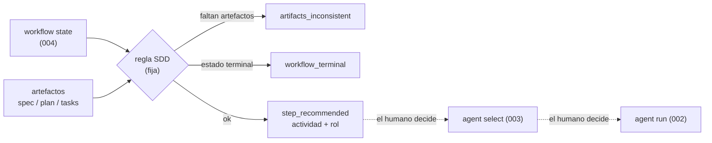

Las flechas discontinuas son pasos que **el humano** decide dar; `ai-dev` no los encadena.

### 006 · Human Gates

Es la única vía de escritura del Workflow State. Una decisión humana explícita (`approve` o `abandon`) se valida contra las reglas de 004 y los artefactos de 005, y se persiste junto con su evidencia en un **único reemplazo atómico** del registro. La evidencia es feature, decisión, aprobador, origen, destino, fecha y motivo.

La aprobación nunca se infiere de comandos anteriores, del éxito de un agente, de los artefactos generados ni del estado actual. El abandono exige `--reason` y el destino `abandoned`.

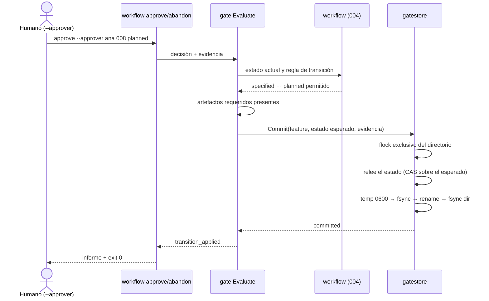

Outcomes posibles:
- `transition_applied`: la transición se aplicó y quedó registrada.
- `artifacts_missing`: faltan los artefactos que exige el estado destino.
- `state_conflict`: el estado cambió entre la lectura y la escritura.
- `persistence_failed`: no se pudo escribir el registro.
- También se reutilizan los refusals de 004.

### 008 · Git Management

Inicializa y configura repositorios Git de forma **supervisada, determinista y auditada** en macOS (APFS) y Linux (ext4 local). Separa estrictamente cuatro fases: **inspeccionar → planificar → autorizar → aplicar**, más una **reconciliación** de solo lectura.

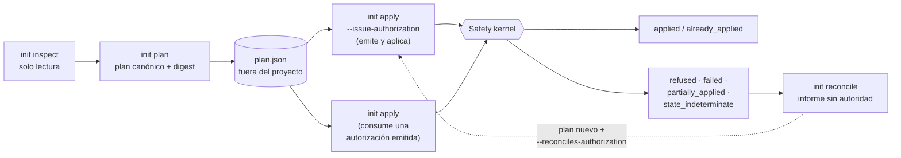

#### Estrategias

| Estrategia | Ramas | Notas |
|---|---|---|
| `basic` | `--initial-branch` | Repositorio mínimo |
| `github-flow` | `--initial-branch` | Rama principal + ramas cortas |
| `trunk-based` | `--trunk-branch` | Una sola rama troncal |
| `git-flow` | `--initial-branch`, `--production-branch`, `--development-branch` + prefijos `feature/bugfix/release/hotfix/support/version-tag` | Dialectos `avh` (exactamente 8 claves `gitflow.*`) y `git-flow-next` |

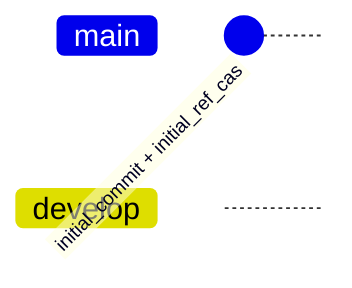

En Git Flow, la rama de desarrollo se crea con un CAS (`development_ref_cas`) que la apunta al commit inicial; no crea un commit nuevo. Si todavía no hay historial, queda como dependencia pendiente (`development_branch_pending_initial_history`) en lugar de inventarse.

#### Inspección

`init inspect` informa de:
- la identidad física del proyecto (device + inode);
- el estado del repositorio, HEAD, refs, índice y worktree;
- operaciones en curso (sequencer);
- la configuración local y Git Flow;
- los riesgos de conversión (`.gitattributes`);
- la configuración de proyecto `.ai-dev/config.json`;
- el filesystem;
- la identidad de la herramienta Git.

Todo se ejecuta bajo un entorno Git saneado: sin configuración del sistema, sin prompts, sin red ni helpers de credenciales.

#### Plan

`init plan` produce un plan **canónico y determinista** identificado por su digest `sha256`. Contiene:
- la lista ordenada de operaciones, con el argv exacto de cada una;
- las precondiciones y postcondiciones;
- las tuplas de aprobación de cada archivo del commit inicial;
- un informe de estrategia.

El plan se escribe solo fuera del proyecto y rechaza destinos inseguros. Regenerarlo sobre el mismo estado produce el mismo digest.

Operaciones posibles:
- `repository_init` y `git_config_write`;
- `create_project_config_directory` y `project_config_write`;
- `initial_commit`, `initial_ref_cas` y `prepared_index`;
- `development_ref_cas`;
- `verification`.

#### Commit inicial opcional

Con `--initial-commit` se planifica un commit a partir de una lista explícita de archivos (`--include`), con su mensaje, autor, committer y fechas.

- **Antes de escribir nada:** el mensaje se valida como Conventional Commit y los archivos se examinan en busca de secretos.
- **Construcción del commit:** blobs, árboles y commit se calculan en proceso y se crean como objetos. La ref se actualiza con CAS sobre una ref inexistente.
- **Índice:** se instala con un protocolo de 13 pasos sobre `index.lock`.
- **Aprobación:** cada archivo exige su tupla (`--approve-file`, o `--approve-ignored-file` si está ignorado), además de `--confirm-initial-commit`.

#### Autorización y su ciclo de vida

Una autorización liga un plan, por su digest, a un proyecto, por su identidad física, y a sus aprobaciones. Se consume **una sola vez**.

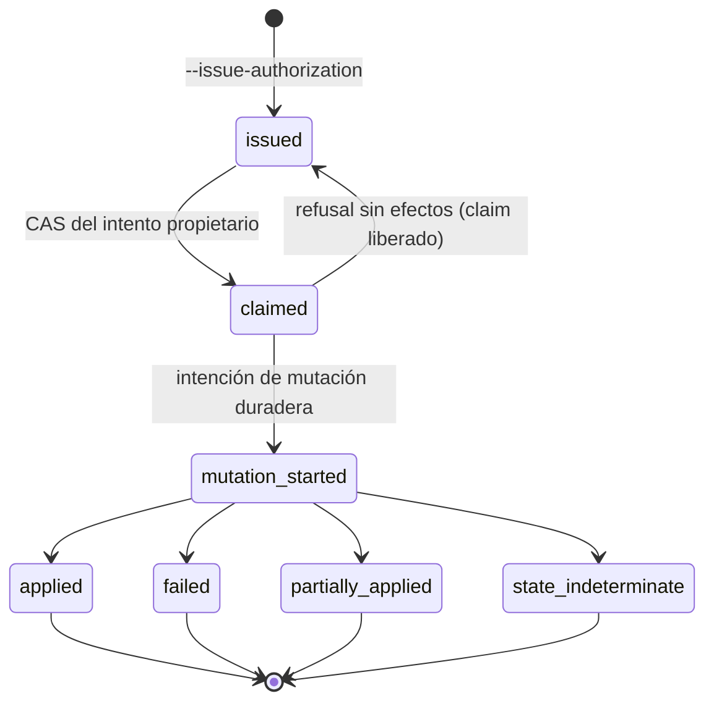

Repetir `apply` con una autorización ya `applied` del mismo plan devuelve `already_applied`, tras verificar de nuevo las postcondiciones bajo el lock. No vuelve a ejecutar nada.

#### Secuencia de apply (safety kernel)

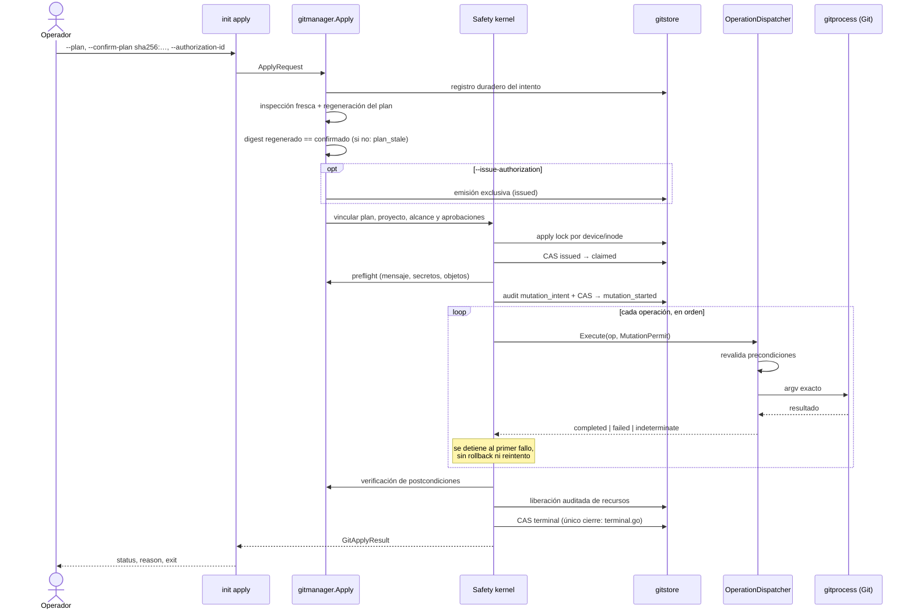

Garantías clave:
- **Sin rollback ni reintento:** ante un fallo, la ejecución se detiene. Las operaciones restantes se informan como no iniciadas y el estado refleja solo la evidencia verificada.
- **Un solo cierre terminal:** `terminal.go` es el único lugar que cierra un intento. Los fallos del almacén cuyo resultado no se puede verificar producen `state_indeterminate`, nunca un éxito supuesto.
- **Ganador único:** ante ejecuciones concurrentes, el CAS del claim y el apply lock garantizan que solo un intento muta.
- **Reconciliación supervisada:** `init reconcile` es de solo lectura y no concede autoridad (`grants_mutation_authority: false`). Para reanudar se necesita un plan nuevo y una autorización nueva que declare `--reconciles-authorization`. Un plan sobre un repositorio que ai-dev ya inicializó adopta la rama registrada en `.ai-dev/config.json`, pero solo si reproduce ese archivo byte a byte (REC-05). Así, la recuperación de una inicialización interrumpida no choca con su propia configuración.
- **Interrupciones (INT-01):**
  - Un Ctrl-C (SIGINT) o un SIGTERM **antes** de mutar se rechaza limpiamente con la *reason* `interrupted`, y la autorización sigue usable.
  - **Durante** la mutación, la interrupción se aplaza: la operación en curso, la verificación, la liberación y el cierre terminal siempre terminan, y no empieza ninguna operación nueva. Git corre en su propio grupo de procesos, así que el Ctrl-C del terminal nunca lo mata a mitad.
  - SIGKILL no se puede aplazar, pero está cubierto por la recuperación tras un crash.
- **Locks de Git:** un `index.lock`, `config.lock`, `HEAD.lock`, `packed-refs.lock` o `refs/**.lock` que haya dejado otro proceso rechaza el plan con `lock_conflict`. Si aparece después, rechaza la operación antes de crear ningún objeto. ai-dev nunca borra un lock ajeno.
- **Efectos no demostrables:** un efecto que no se puede demostrar ausente nunca se informa como `failed`, sino como `state_indeterminate`.

#### Configuración de proyecto

Una vez aplicado, el plan deja `.ai-dev/config.json` (0644) con la estrategia y las ramas. Se escribe con el ciclo temp 0600 → chmod → fsync → verificación del digest → `link` al destino ausente. **Nunca sobrescribe** un archivo existente. Un plan posterior compara la configuración con el repositorio (`compatible` o `configuration_mismatch`).

#### Asistente interactivo

`ai-dev init` sin subcomando guía paso a paso:
1. Elegir la estrategia (no hay valor por defecto).
2. Decidir si se inicializa el repositorio.
3. Indicar las ramas.
4. Indicar el destino del plan y confirmar la escritura.
5. **Teclear el digest del plan.**
6. Indicar el operador declarado.

Hasta completar todas las confirmaciones no se crea ninguna autoridad. Sin TTY se rechaza con `interactive_terminal_required`, y la cancelación o un EOF terminan sin efectos.

#### Validador Conventional Commits

`ai-dev git commit validate` es independiente de Git: valida tipo, ámbito, `!`, descripción, cuerpo, footers y `BREAKING CHANGE` con un límite de tamaño. Es el mismo validador que usa el commit inicial.

```sh
ai-dev git commit validate --message "feat(git): add initial commit"
```

#### Ejemplo no interactivo de principio a fin

```sh
ai-dev init inspect --project-dir ./mi-proyecto

ai-dev init plan --project-dir ./mi-proyecto --strategy trunk-based \
  --initialize-repository --trunk-branch trunk \
  --initial-commit --initial-commit-message-file ../msg.txt --include README.md \
  --author-name Ada --author-email ada@example.org \
  --committer-name Ada --committer-email ada@example.org \
  --author-date 2026-11-18T10:00:00Z --committer-date 2026-11-18T10:00:00Z \
  --output ../plan.json --format json

ai-dev init apply --plan ../plan.json --confirm-plan sha256:<digest> \
  --authorization-id <uuid> --issue-authorization --authorized-by operator \
  --confirm-initial-commit --approve-file '<tupla del plan>'

ai-dev init reconcile --plan ../plan.json --authorization-id <uuid>
```

---

## Modelo de seguridad

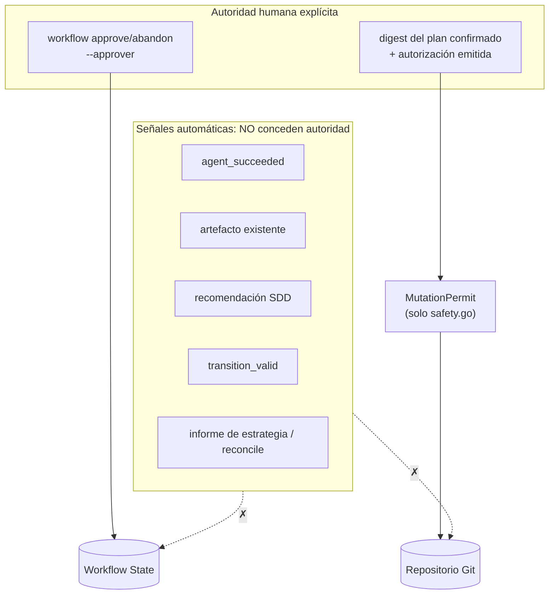

- **Autoridad humana:** ninguna señal automática aprueba, transiciona ni muta.
- **Sin shell ni red:** Git se invoca con argv exacto, sin `sh -c`. Lleva `protocol.allow=never`, `credential.helper=`, `core.sshCommand=false`, `GIT_TERMINAL_PROMPT=0` y `GIT_CONFIG_NOSYSTEM=1`.
- **Sin secretos en la salida:** las credenciales de la configuración del usuario nunca aparecen en la salida ni en los registros duraderos. Los archivos del commit inicial se examinan en busca de secretos antes de crear el primer objeto.
- **Rutas literales:** se rechazan rutas no literales y enlaces simbólicos. Cada componente se abre con `O_NOFOLLOW` y se vuelve a comprobar su identidad tras la lectura.
- **Fallo cerrado:** plataformas o filesystems no soportados (tmpfs, remotos, de solo lectura) devuelven un refusal tipado y nunca un éxito parcial supuesto.

---

## Persistencia

| Dato | Ubicación | Escrito por |
|---|---|---|
| Workflow State + evidencia de Gate | `specs/<feature-id>/workflow-state.json` | `gatestore` (atómico, con flock) |
| Configuración de proyecto | `<proyecto>/.ai-dev/config.json` | `gitmanager` (sin sobrescritura) |
| Autorizaciones, auditoría y locks de Git | macOS: `~/Library/Application Support/ai-dev/state/git`<br/>Linux: `$XDG_STATE_HOME/ai-dev/git` o `~/.local/state/ai-dev/git` | `gitstore` |

```text
<state-root>/
├── attempts/<apply-id>/events/   auditoría ordenada de cada intento
├── environment/                  HOME y XDG inexistentes del entorno Git saneado
├── locks/by-device-inode/<key>/  apply lock por identidad física del proyecto
├── prepared/<random>/            almacenamiento privado del índice preparado
└── projects/<project-digest>/
    ├── authorizations/<uuid>.json
    └── attempts/
```

---

## Desarrollo y calidad

```sh
gofmt -l .                               # debe no listar nada
go vet ./...
go test ./...
go test -race -timeout 60m ./internal/gitstore ./internal/gitmanager ./internal/app ./cmd/ai-dev
```

La suite combina:
- **Pruebas unitarias** de cada dominio.
- **Fuzzing:** codificación canónica, decodificación del plan, atributos y Conventional Commits.
- **Integración con Git real**, en directorios temporales aislados.
- **Una matriz de fallos** (T110) que inyecta errores antes y después de cada paso duradero del almacén.
- **Pruebas de carrera** (T111) para CAS, locks y cierre terminal.
- **Pruebas estructurales:** fronteras entre paquetes, imposibilidad de saltarse el `MutationPermit` y trazabilidad de FR-001–192 y AC-001–032 hacia archivos y pruebas existentes.
- **Pruebas end-to-end** de la CLI pública por subproceso.

Las pruebas que aplican cambios reales con Git exigen un **filesystem de producción** en el directorio temporal: APFS en macOS, ext4 local en Linux. En tmpfs se saltan, porque el producto lo rechaza correctamente.

Evidencia verificada (2026-11-18), con el mismo código en ambas plataformas:

| Plataforma | Git | Suite | `-race -count=3` |
|---|---|---|---|
| macOS 27 / APFS (arm64) | 2.54.0 | 2322 PASS, 0 FAIL | sin carreras |
| Linux 7.1 / ext4 (loop en VM, Fedora 44, usuario no root) | 2.56.1 | 2322 PASS, 0 FAIL | sin carreras |

Incluye:
- **Recuperación tras un crash:** 92 SIGKILL reales, uno antes y otro después de cada paso duradero.
- **Interrupciones:** 168 interrupciones reales (SIGINT, SIGTERM y SIGHUP) y la salida forzada con una segunda interrupción.
- **Fallos de I/O:** inyección de EIO, ENOSPC y EDQUOT en cada paso.
- **Hooks:** ninguno se ejecuta con Git real, con un control negativo que demuestra que los hooks estaban activos.
- **Git Flow:** `git-flow-next` validado con la herramienta real 2.1.0.

La revisión independiente está en [`specs/008-git-management/review.md`](specs/008-git-management/review.md). El workflow de CI está en [`.github/workflows/ci.yml`](.github/workflows/ci.yml); aún no se ha ejecutado, porque requiere hacer push.

---

## Proceso de ingeniería

El proyecto sigue **Spec Kit** y una [constitución](.specify/memory/constitution.md) con nueve principios:

1. Specification First
2. Architecture Before Framework
3. Simplicity / YAGNI
4. Testable by Design
5. Security by Design
6. Observability by Design
7. Reproducibility and Automation
8. AI-Assisted Engineering
9. Human Authority

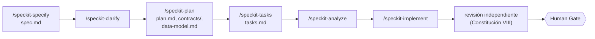

Un agente nunca registra una aprobación humana en nombre de una persona. Las desviaciones de diseño se anotan como "propuestas, pendientes de aprobación humana" en `tasks.md` y en `contracts/` hasta que el responsable las aprueba. En la Feature 008, el responsable delegó esas decisiones el 2026-11-18, así que quedaron registradas como "aceptadas bajo delegación" después de la revisión independiente, nunca como una aprobación individual suya.

---

## Limitaciones conocidas

- **Plataformas:** solo macOS (APFS) y Linux (ext4 local) son filesystems de producción para Git Management.
- **Evidencia de Linux:** se obtuvo en ext4 montado por loop dentro de una VM, no en un host Linux nativo.
- **Versión mínima de Git (2.45):** está declarada, pero no se ha ejecutado la suite con esa versión (VER-01).
- **Ventana residual de recuperación (REC-06):** si el proceso muere después de crear el commit y antes de instalar el índice, la recuperación usa los comandos de Git (`git read-tree HEAD` o borrar `.git/index.lock`).
- **Claims huérfanos (REC-07):** una autorización cuyo claim quedó huérfano por un crash antes de la intención no se reasigna; hay que emitir una nueva.
- **SIGKILL:** no se puede aplazar; se recupera por la vía de crash.
- **Fuera de alcance por diseño:**
  - autenticación de agentes;
  - selección automática, reintentos o encadenamiento de agentes;
  - orquestación en segundo plano;
  - operaciones Git remotas (push, fetch);
  - commits más allá del inicial.
