# ai-dev — AI Dev Orchestrator

**English** · [Español](README.es.md)

`ai-dev` is a Go CLI that supports a Spec-Driven Development (SDD) process with coding agents (Claude Code and Codex CLI), **without ever taking authority away from the human**. It diagnoses the environment, runs agents explicitly, selects the right agent for each role, tracks each feature's lifecycle state, records human decisions (Human Gates) and manages the supervised initialization of Git repositories.

The principle that runs through the whole design:

> `agent_succeeded` ≠ workflow transition ≠ human approval

An agent finishing successfully, an artifact existing or a transition being valid **never** authorizes anything by itself. Every change to state or to a repository requires an explicit, verifiable human decision.

---

## Contents

1. [Current status](#current-status)
2. [Installation and requirements](#installation-and-requirements)
3. [Command reference](#command-reference)
4. [Architecture](#architecture)
5. [Features](#features)
   - [001 · Environment Doctor](#001--environment-doctor)
   - [002 · Coding Agent Execution](#002--coding-agent-execution)
   - [003 · Agent Role Selection](#003--agent-role-selection)
   - [004 · Workflow State](#004--workflow-state)
   - [005 · SDD Workflow](#005--sdd-workflow)
   - [006 · Human Gates](#006--human-gates)
   - [007 · Workflow Orchestration (guided mode)](#007--workflow-orchestration-guided-mode)
   - [008 · Git Management](#008--git-management)
   - [011 · Agent Detection and Role Configuration](#011--agent-detection-and-role-configuration)
   - [012 · Terminal Cockpit](#012--terminal-cockpit)
6. [Security model](#security-model)
7. [Persistence](#persistence)
8. [Development and quality](#development-and-quality)
9. [Engineering process](#engineering-process)
10. [Known limitations](#known-limitations)
11. [License](#license)

---

## Current status

| Feature | Command(s) | Status |
|---|---|---|
| 001 Environment Doctor | `ai-dev doctor` | Implemented |
| 002 Coding Agent Execution | `ai-dev agents`, `ai-dev agent run` | Implemented |
| 003 Agent Role Selection | `ai-dev agent select` | Implemented |
| 004 Workflow State | `ai-dev workflow state`, `ai-dev workflow transition` | Implemented |
| 005 SDD Workflow | `ai-dev workflow next` | Implemented (read-only) |
| 006 Human Gates | `ai-dev workflow approve`, `ai-dev workflow abandon` | Implemented |
| 007 Workflow Orchestration | `ai-dev workflow guide` | Guided mode implemented (read-only); autonomous mode deferred until it passes its safety gates |
| 008 Git Management | `ai-dev init …`, `ai-dev git commit validate` | Implemented, independently reviewed, with evidence on macOS/APFS, Linux/ext4 (VM) and Git 2.45.0 in CI |
| 009 CLI Help and Version | `ai-dev version`, `ai-dev help` | Implemented |
| 010 Command Help and Shell Completion | `ai-dev <command> --help`, `ai-dev help <command>`, `ai-dev completion` | Implemented |
| 011 Agent Detection and Role Configuration | `ai-dev setup`, `ai-dev setup show`, `ai-dev setup apply` | Implemented |
| 012 Terminal Cockpit | `ai-dev tui` | Implemented |

Each feature has its specification, plan, contracts, data model and tasks in [`specs/`](specs/).

---

## Installation and requirements

- **Go 1.27.4**, only to build from source (see [`go.mod`](go.mod)); installing from a release does not need it. The only third-party dependencies are the cockpit's (012), pinned under the [dependency policy](#third-party-dependencies).
- **Platforms:** macOS and Linux. Operations with durable state fail closed (`platform_unsupported`) on native Windows (including PowerShell), iOS and Android.
- **Windows:** use ai-dev inside **WSL2**, with a Linux distribution and that distribution's Git. The project and `HOME` must be on the Linux filesystem (for example `~/projects/…`, which is ext4). A project under `/mnt/c/…` is mounted as `9p` (drvfs) and Git Management refuses it (`filesystem_unsupported`), because it is not a local production filesystem.
- **Git ≥ 2.45** for Git Management (it uses `init --ref-format` and `config --end-of-options`).
  - Verified Git installations: Apple (Xcode or Command Line Tools), `/usr` and Debian/Ubuntu (`/usr/lib/git-core`), `/usr/local` and Homebrew. With any other layout, inspection is refused (`attributes_incompatible`), because ai-dev cannot exactly evaluate the configuration compiled into that Git.
- Optional, depending on what you use: `specify` (Spec Kit), `claude` (Claude Code), `codex` (Codex CLI).

### Install from a release (no Go or Git needed)

[`scripts/install.sh`](scripts/install.sh) downloads the binary from a GitHub release and needs only `curl`, `tar` and `sha256sum` or `shasum`, which macOS and Linux provide:

```sh
curl -fsSLO https://raw.githubusercontent.com/germanmunozs/ai-dev/main/scripts/install.sh
less install.sh                          # read it before running it
sh install.sh                            # latest release, into ~/.local/bin
sh install.sh --version v0.1.0           # a specific release
sh install.sh --prefix /opt/ai-dev/bin   # another destination
sh install.sh --uninstall                # removes the binary, only if it is ai-dev
```

- It detects the system (macOS or Linux) and the architecture (amd64 or arm64), and downloads that platform's archive along with `SHA256SUMS`.
- It installs nothing if the checksum does not match. If the GitHub CLI (`gh`) is installed, it also verifies the signed provenance attestation; without `gh`, it warns that only the checksum was verified.
- It checks that the downloaded binary reports the requested version, and installs it with an atomic replacement.
- It accepts only `vX.Y.Z` releases; pre-releases are refused.
- It does not edit shell startup files, configuration or credentials: if the destination is not on your `PATH`, it tells you what to add.

### Build from source

```sh
go build -o ai-dev ./cmd/ai-dev
./ai-dev --version
./ai-dev doctor
```

### Install a development build for testing

To try changes that are not in a release yet, [`scripts/install-dev.sh`](scripts/install-dev.sh) builds this checkout and puts the binary in `~/.local/bin/ai-dev`. It marks the version as `v0.1.0-dev+<commit>`, with `.dirty` if there are uncommitted changes. It does not edit shell startup files, configuration or credentials: if `~/.local/bin` is not on your `PATH`, it tells you what to add.

```sh
scripts/install-dev.sh                      # build and install (--prefix DIR for another destination)
scripts/install-dev.sh --sandbox ~/ai-dev-sandbox
cd ~/ai-dev-sandbox/project
PATH="$HOME/ai-dev-sandbox/fake-agents:$PATH" ai-dev tui   # with fake agents that only print their arguments
scripts/install-dev.sh --uninstall          # removes the binary, only if it is ai-dev
rm -rf ~/ai-dev-sandbox
```

The sandbox is a git repository with one feature (`specs/001-demo`) and fake `claude` and `codex` commands, for trying `ai-dev setup`, `ai-dev tui` and `ai-dev agent run` without starting real agents. Without the fakes on `PATH`, the real agents are used.

A local build reports the version Go assigns to it and its commit. For a release, the version is set at link time:

```sh
go build -ldflags "-X github.com/germanmunozs/ai-dev/internal/version.Version=v0.1.0" -o ai-dev ./cmd/ai-dev
```

You can also install with `go install github.com/germanmunozs/ai-dev/cmd/ai-dev@latest`, or download a binary from [Releases](https://github.com/germanmunozs/ai-dev/releases). Each release has one archive per platform (macOS and Linux, amd64 and arm64), `SHA256SUMS` and a signed provenance attestation. To verify it before use:

```sh
shasum -a 256 -c SHA256SUMS --ignore-missing
gh attestation verify ai-dev_v0.1.0_darwin_arm64.tar.gz --repo germanmunozs/ai-dev
```

**Publishing a release** (project maintainer):
1. On `dev`, the `[Unreleased]` section of [`CHANGELOG.md`](CHANGELOG.md) (English) and of [`CHANGELOG.es.md`](CHANGELOG.es.md) (Spanish) becomes `[X.Y.Z] - YYYY-MM-DD`.
2. `dev` is merged into `main` through a pull request with the checks passing.
3. The tag `vX.Y.Z` is created and pushed on that `main` commit. A repository ruleset lets only its administrators create, move or delete `v*` tags.

The [`release.yml`](.github/workflows/release.yml) workflow rejects tags that are not `vX.Y.Z`, are not on `main` or have no section in `CHANGELOG.md`, whose English text becomes the release notes. It builds with the tag's version, produces the archives and `SHA256SUMS`, signs the provenance and creates the release.

---

## Command reference

Every command accepts `--format text|json`. Text is for humans; JSON is stable and meant for automation.

| Command | What it does | Does it change anything? |
|---|---|---|
| `ai-dev doctor` | Diagnoses whether the environment and the repository are ready | No |
| `ai-dev agents` | Lists the supported agents and their local availability | No |
| `ai-dev agent run <agent-id> [instruction]` | Runs an agent with an instruction (argument or stdin) | Whatever the agent does, under its own sandbox |
| `ai-dev agent select <role>` | Says which agent a role maps to | No |
| `ai-dev workflow state <feature-id>` | Reports a feature's current state | No |
| `ai-dev workflow transition <feature-id> <target>` | Evaluates whether a transition is valid | No |
| `ai-dev workflow next <feature-id>` | Recommends the next SDD step | No |
| `ai-dev workflow guide <feature-id>` | Guides the next human action: SDD step, the role's agent, its availability and command templates to complete | No |
| `ai-dev workflow approve --approver ID [--reason T] <feature-id> <target>` | Records a human approval and applies the transition | Yes: `workflow-state.json` |
| `ai-dev workflow abandon --approver ID --reason T <feature-id> abandoned` | Records a human abandonment | Yes: `workflow-state.json` |
| `ai-dev init [--project-dir PATH]` | Interactive Git wizard (requires a TTY) | Only after the plan digest is confirmed |
| `ai-dev init inspect` | Inspects the project and its repository | No |
| `ai-dev init plan … --output FILE` | Produces a deterministic plan and writes it outside the project | Only the plan file |
| `ai-dev init apply --plan FILE --confirm-plan sha256:… --authorization-id UUID …` | Issues or consumes an authorization and applies the plan | Yes: repository and configuration |
| `ai-dev init reconcile --plan FILE --authorization-id UUID` | Reconciliation report for an interrupted attempt | No |
| `ai-dev git commit validate (--message T \| --file F)` | Validates a Conventional Commits message | No |
| `ai-dev version` (or `--version`) | Says which build is running: version, commit, Go and platform | No |
| `ai-dev help` (or `--help`, `-h`) | Lists every command with its description | No |
| `ai-dev <command> --help` (or `-h`, or `ai-dev help <command>`) | Help for one command or group: usage, arguments, options and their values, what it changes and exit codes | No |
| `ai-dev completion bash\|zsh` | Writes a static completion script | No |
| `ai-dev setup` | Interactive wizard (requires a TTY): chooses the project's agents and assigns one to each role | Only after confirmation: `.ai-dev/agents.json` |
| `ai-dev setup show` | Shows the detected agents and the current role assignment, and where it comes from | No |
| `ai-dev setup apply --agent A… --role ROLE=AGENT… [--replace]` | Writes the same configuration without prompting | Yes: `.ai-dev/agents.json` |
| `ai-dev tui` | Interactive terminal cockpit (requires a TTY): feature state, environment, agents and repository, and launching the actions | Nothing by itself; each action runs its own command after it is confirmed |

`--help` and `-h` are recognized only right after the command: `ai-dev agent run claude-code --help` sends `--help` as the instruction, without showing the help.

**Completion.** The scripts are static: completing runs no program and reads no file's contents. They work in bash 3.2 or later (the macOS one) and zsh 5. In zsh they can also be installed as `_ai-dev` in an `fpath` directory. ai-dev never modifies shell startup files:

```sh
# bash (~/.bashrc); eval also works in bash 3.2, where source <(...) reads nothing
eval "$(ai-dev completion bash)"
# zsh (~/.zshrc, after compinit)
eval "$(ai-dev completion zsh)"
```

**Exit codes (uniform):**

| Code | Meaning |
|---|---|
| `0` | Positive result: ready, agent success, valid transition, `applied` or `already_applied` |
| `1` | Negative domain result: not ready, refusal, agent failure, indeterminate state |
| `2` | Incorrect usage or internal failure before evaluation |

---

## Architecture

### System context

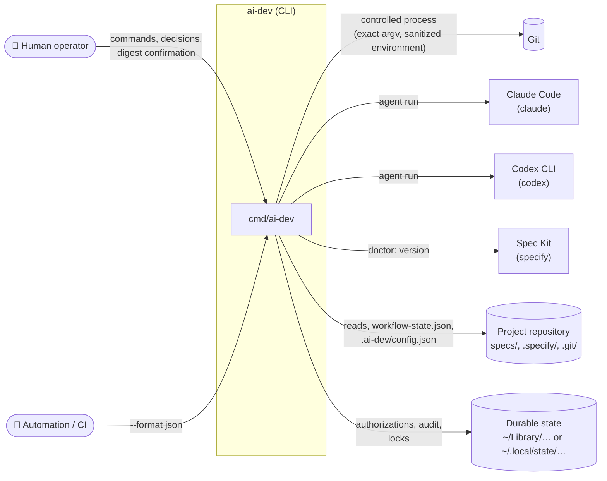

### Layers and package dependencies

The architecture is hexagonal: domain packages know nothing about concrete processes, terminals or filesystems. Adapters implement ports defined by the domain, and `internal/app` is the *composition root*.

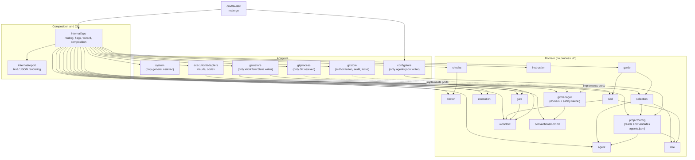

Structural tests in the repository enforce these boundaries:
- `gitmanager` imports only the standard library and `conventionalcommit`.
- `os/exec` is forbidden outside `gitprocess` (for Git) and `system`.
- Git Management does not import `workflow`, `gate`, `gatestore`, `role`, `selection`, `agent` or `execution`: it cannot grant Workflow or Human Gate authority.
- No production file other than `safety.go` can construct a `MutationPermit`.
- Only `configstore` can write `.ai-dev/agents.json`, only `cmd/ai-dev/main.go` imports it, and `configstore` cannot name 008's `config.json`.
- `guide` imports only `sdd`, `selection`, `agent`, `role`, `workflow` and three standard-library packages. It cannot build its own agent registry, evaluate transitions, start processes or read the environment.

### Repository layout

```text
cmd/ai-dev/              entry point and end-to-end subprocess tests
internal/
  app/                   composition, command routing, interactive wizard
  report/                text/JSON rendering of every report
  doctor/ checks/        001 — readiness model and the nine checks
  agent/ execution/      002 — agent catalog and execution model
    execution/adapters/        claude/codex adapters
  instruction/           002 — instruction source (argument or stdin)
  role/ selection/       003 — roles and role → agent policy (built-in or project, 011)
  projectconfig/         011 — strict reading and validation of .ai-dev/agents.json
  configstore/           011 — atomic writing of .ai-dev/agents.json
  cockpit/               012 — cockpit presentation (Bubble Tea), no authority or domain
  workflow/              004 — states, transition rules, record
  sdd/                   005 — next-step recommendation
  gate/ gatestore/       006 — human decisions and their atomic persistence
  gitmanager/            008 — Git domain, planning, safety kernel
  gitprocess/            008 — Git process adapter
  gitstore/              008 — durable store for authorizations and audit
  conventionalcommit/    008 — standalone Conventional Commits validator
  system/                external process boundary and agent launcher
scripts/install.sh       installation from a GitHub release (no Go or Git)
scripts/install-dev.sh   development installation for manual testing
specs/NNN-*/             spec, plan, contracts, data model, tasks per feature
.specify/                Spec Kit configuration and the project constitution
```

---

## Features

### 001 · Environment Doctor

`ai-dev doctor` runs **nine independent checks**, always in the same order. One failing does not stop the others from running; each failure explains what is missing and how to fix it.

| # | ID | Area | Checks |
|---|---|---|---|
| 1 | `git-tool` | Environment | `git` installed and executable |
| 2 | `speckit-tool` | Environment | `specify` installed |
| 3 | `claude-code-tool` | Environment | `claude` installed |
| 4 | `codex-cli-tool` | Environment | `codex` installed |
| 5 | `git-repository` | Repository | The current directory is a Git repository |
| 6 | `speckit-initialized` | Repository | Valid `.specify/integrations/speckit.manifest.json` |
| 7 | `constitution` | Repository | Complete `.specify/memory/constitution.md` (no placeholders, with Version and Ratified) |
| 8 | `claude-integration` | Repository | Spec Kit Claude integration installed |
| 9 | `codex-integration` | Repository | Spec Kit Codex integration installed |

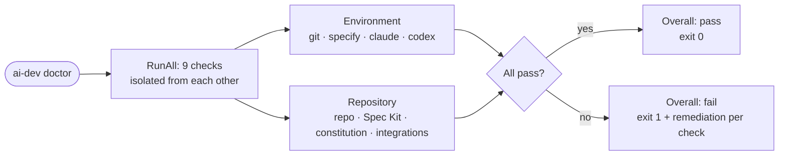

Detecting Claude and Codex authentication is **out of scope** on purpose: it is not inferred.

### 002 · Coding Agent Execution

A provider-neutral abstraction for discovering and invoking agents. It supports `claude-code` and `codex-cli` today, and others can be added without changing the execution model.

| Agent | Executable | Invocation |
|---|---|---|
| `claude-code` | `claude` | `claude --print -- <instruction>` |
| `codex-cli` | `codex` | `codex exec -- <instruction>` |

The instruction arrives as an argument **or** through non-interactive stdin, never both at once. `ai-dev` does not raise permissions or bypass the agent's sandbox or approvals. The instruction always comes after `--`, so an instruction that starts with `-` is never read as an agent option (002, amendment 1).

The result distinguishes three outcomes:
- `agent_succeeded`: the agent finished successfully.
- `agent_failed`: the agent ran and finished with an unsuccessful result.
- `execution_failed`: `ai-dev` could not start or supervise it.

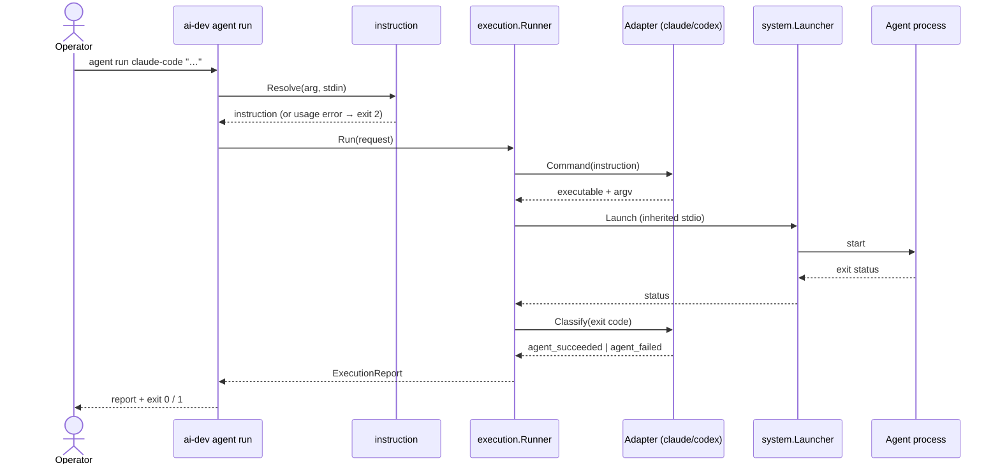

### 003 · Agent Role Selection

Given an explicit development role, it determines which agent to use and reports it. Selection is deterministic and read-only: **it does not run, start, authenticate or reconfigure any agent**. The table below is the built-in assignment (`source=built_in`); a project can replace it with its [Feature 011](#011--agent-detection-and-role-configuration) configuration (`source=project`).

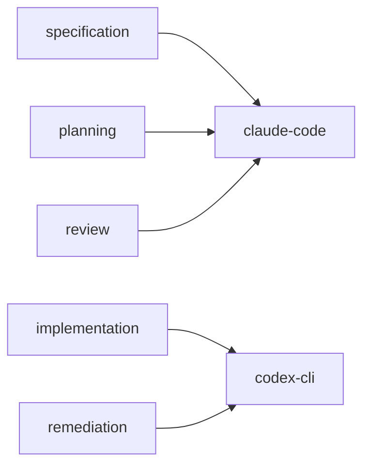

Possible outcomes:
- `role_selected`: the role is valid and its agent is available.
- `role_unsupported`: the role is not one of the five canonical roles.
- `agent_unavailable`: the role's agent is not available locally.
- `selection_inconsistent`: the result fails validation against the built-in policy.
- `configuration_invalid`: the project configuration (`.ai-dev/agents.json`) is not valid; no agent is named and there is no fallback to the built-in assignment.

### 004 · Workflow State

Represents a feature's lifecycle state. The record lives in `specs/<feature-id>/workflow-state.json`; if it does not exist, the state is `draft`. The `state` and `transition` commands **only read**: `transition` evaluates whether a change is valid but does not apply it.

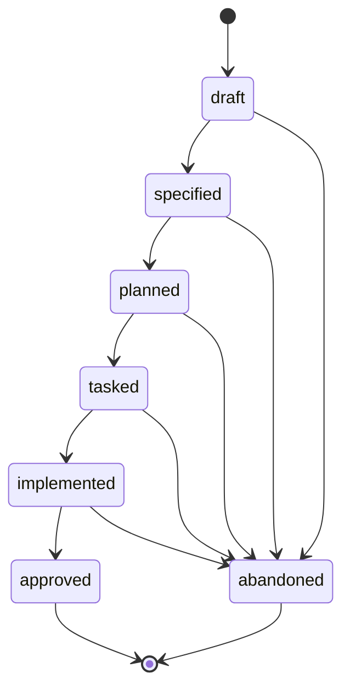

`approved` and `abandoned` are terminal.

Possible outcomes:
- `state_reported`: the current state was reported.
- `feature_unknown`: the feature does not exist.
- `state_invalid`: the state record is not valid.
- `transition_valid` and `transition_invalid`: the requested transition is or is not allowed by the rules.
- `target_unsupported`: the target state is not one of the canonical states.

### 005 · SDD Workflow

`ai-dev workflow next` connects state (004), roles (003) and the Spec Kit artifacts to **recommend** the next step. It only recommends: it separates "what should happen next" from "authorizing it to happen". It runs no agents and persists nothing.

| Current state | Recommended activity | Role | Required artifacts |
|---|---|---|---|
| `draft` | specify | specification | — |
| `specified` | plan | planning | `spec.md` |
| `planned` | tasks | planning | `spec.md`, `plan.md` |
| `tasked` | implement | implementation | `spec.md`, `plan.md`, `tasks.md` |
| `implemented` | review | review | `spec.md`, `plan.md`, `tasks.md` |
| `approved` / `abandoned` | — (`workflow_terminal`) | — | — |

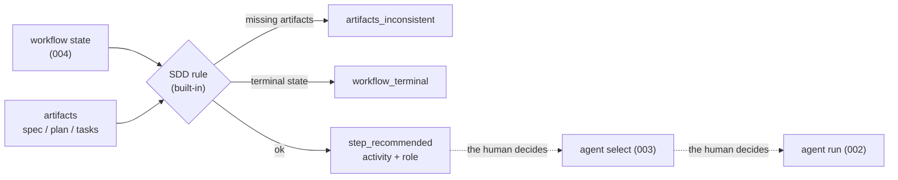

The dashed arrows are steps that **the human** decides to take; `ai-dev` does not chain them.

### 006 · Human Gates

The only way to write the Workflow State. An explicit human decision (`approve` or `abandon`) is validated against the 004 rules and the 005 artifacts, and persisted together with its evidence in a **single atomic replacement** of the record. The evidence is feature, decision, approver, source, target, date and reason.

Approval is never inferred from earlier commands, an agent's success, generated artifacts or the current state. Abandonment requires `--reason` and the target `abandoned`.

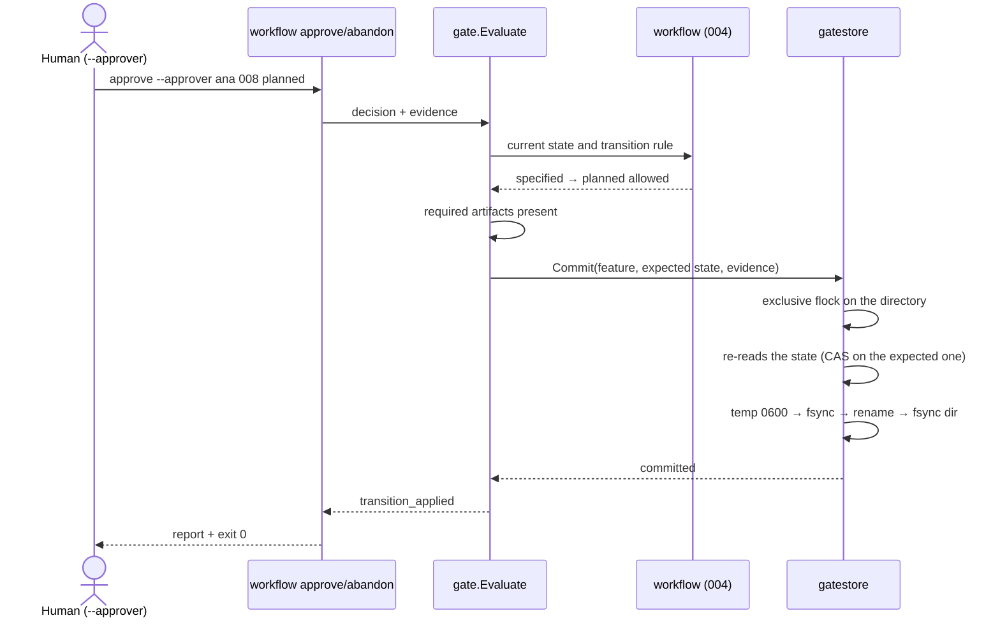

Possible outcomes:
- `transition_applied`: the transition was applied and recorded.
- `artifacts_missing`: the artifacts the target state requires are missing.
- `state_conflict`: the state changed between the read and the write.
- `persistence_failed`: the record could not be written.
- The 004 refusals are reused as well.

### 007 · Workflow Orchestration (guided mode)

`ai-dev workflow guide` answers, for one feature, the question "what do I do now?". It brings together in a single read-only report:
- the 005 SDD step (outcome, state, activity and role), identical to `workflow next`'s;
- the agent that role maps to under 003 and its availability (`available`, `unavailable` or `inconsistent`);
- the templates for the next human actions (`agent select`, `agent run`, `workflow transition`, `workflow approve`), or `workflow state` if the feature is terminal;
- a fixed statement: the actions are options for the human, not authorization. Running an agent or a review is not approving.

It runs no template, starts no process, writes nothing and does not read stdin. Its exit codes are `workflow next`'s. The JSON carries `schema_version: "ai-dev.workflow-guide/v1"`.

```text
$ ai-dev workflow guide 009-search
ai-dev: outcome=step_recommended feature="009-search" state=specified activity=plan role=planning agent=claude-code availability=available note="options for the human only; not authorization. …"
  # select the agent for this role (003)
  ai-dev agent select -- planning
  # run the agent (002)
  ai-dev agent run -- claude-code )instruction(
  # after completing the activity, check the transition (004)
  ai-dev workflow transition -- '009-search' )target-state(
  # then record your decision (006)
  ai-dev workflow approve --approver )approver( -- '009-search' )target-state(
  # replace each )slot( before running; --reason )reason( is optional for approval (006 FR-010)
```

**The templates are for completing, not for pasting as-is:**
- **Human slots:** every value the human decides (`)instruction(`, `)approver(`, `)target-state(`) appears unquoted between inverted parentheses. That `)` which closes nothing is a syntax error in every POSIX shell, so a template pasted without being completed does not invoke `ai-dev` or any agent and touches no file. The tests verify this in sh, dash, bash and zsh, including zsh options such as `emulate sh`, `shglob` or `kshglob`, under which an ordinary `(slot)` would run.
- **Nothing derived:** the guide never fills those slots. It does not infer the target state, the approver or the instruction from the environment, Git or the system user.
- **Feature identifier:** it goes in single quotes after `--`, so names with `;`, `$( )`, spaces or a leading `-` arrive as a single argument. If the identifier contains control or format characters (for example U+202E or U+200B), the report comes out without templates.
- **Labels as comments:** each label goes on its own `#` line, above its command. Pasting a whole line, or the whole report, never runs a word of the label. Only the command lines are meant to be pasted.

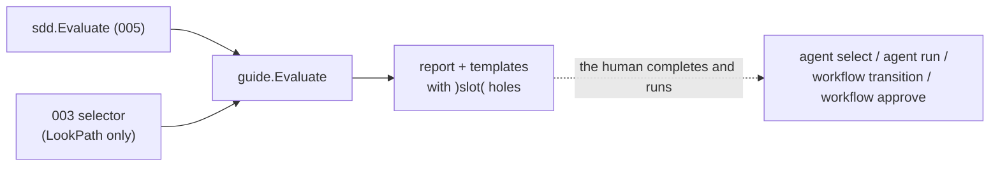

**Autonomous mode** (chaining agents without intervention) does not exist in the code. Its design is in the specification as a deferred, non-normative section, blocked until it passes its safety gates.

### 008 · Git Management

Initializes and configures Git repositories in a **supervised, deterministic and audited** way on macOS (APFS) and Linux (local ext4). It strictly separates four phases: **inspect → plan → authorize → apply**, plus a read-only **reconciliation**.

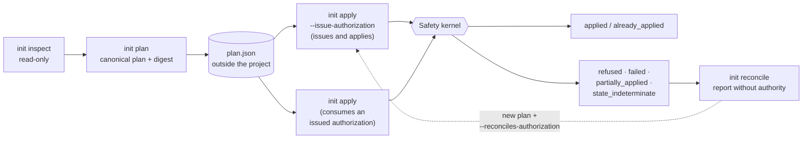

#### Strategies

| Strategy | Branches | Notes |
|---|---|---|
| `basic` | `--initial-branch` | Minimal repository |
| `github-flow` | `--initial-branch` | Main branch + short-lived branches |
| `trunk-based` | `--trunk-branch` | A single trunk branch |
| `git-flow` | `--initial-branch`, `--production-branch`, `--development-branch` + prefixes `feature/bugfix/release/hotfix/support/version-tag` | Dialects `avh` (exactly 8 `gitflow.*` keys) and `git-flow-next` |

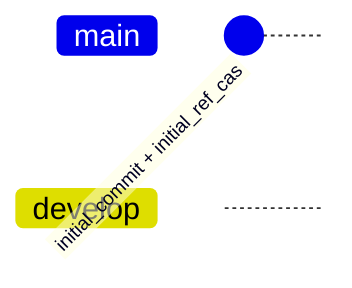

In Git Flow, the development branch is created with a CAS (`development_ref_cas`) that points it at the initial commit; it does not create a new commit. If there is no history yet, it stays as a pending dependency (`development_branch_pending_initial_history`) instead of being invented.

#### Inspection

`init inspect` reports:
- the project's physical identity (device + inode);
- the state of the repository, HEAD, refs, index and worktree;
- operations in progress (sequencer);
- local and Git Flow configuration;
- conversion risks (`.gitattributes`);
- the `.ai-dev/config.json` project configuration;
- the filesystem;
- the identity of the Git tool.

Everything runs under a sanitized Git environment: no system configuration, no prompts, no network and no credential helpers.

#### Plan

`init plan` produces a **canonical, deterministic** plan identified by its `sha256` digest. It contains:
- the ordered list of operations, with the exact argv of each;
- the preconditions and postconditions;
- the approval tuples for each file in the initial commit;
- a strategy report.

The plan is written only outside the project and unsafe destinations are refused. Regenerating it on the same state produces the same digest.

Possible operations:
- `repository_init` and `git_config_write`;
- `create_project_config_directory` and `project_config_write`;
- `initial_commit`, `initial_ref_cas` and `prepared_index`;
- `development_ref_cas`;
- `verification`.

#### Optional initial commit

With `--initial-commit`, a commit is planned from an explicit list of files (`--include`), with its message, author, committer and dates.

- **Before writing anything:** the message is validated as a Conventional Commit and the files are scanned for secrets.
- **Building the commit:** blobs, trees and commit are computed in process and created as objects. The ref is updated with a CAS on a nonexistent ref.
- **Index:** installed with a 13-step protocol over `index.lock`.
- **Approval:** each file requires its tuple (`--approve-file`, or `--approve-ignored-file` if it is ignored), plus `--confirm-initial-commit`.

#### Authorization and its lifecycle

An authorization binds a plan, by its digest, to a project, by its physical identity, and to its approvals. It is consumed **only once**.

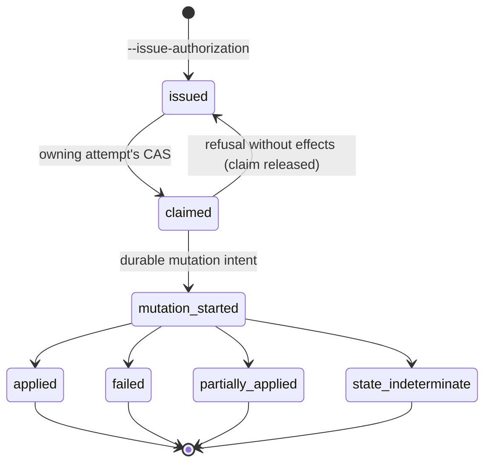

Repeating `apply` with an already `applied` authorization for the same plan returns `already_applied`, after verifying the postconditions again under the lock. It runs nothing again.

#### Apply sequence (safety kernel)

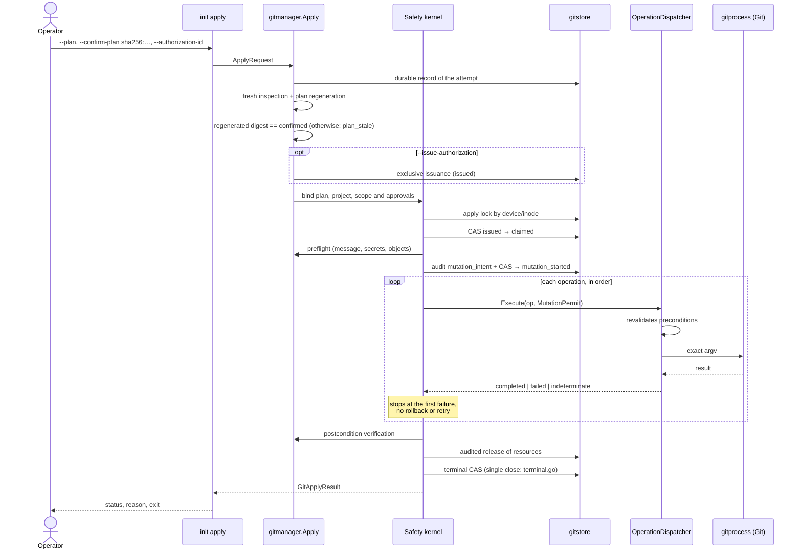

Key guarantees:
- **No rollback or retry:** on a failure, execution stops. The remaining operations are reported as not started and the state reflects only verified evidence.
- **A single terminal close:** `terminal.go` is the only place that closes an attempt. Store failures whose outcome cannot be verified produce `state_indeterminate`, never an assumed success.
- **A single winner:** with concurrent runs, the claim CAS and the apply lock guarantee that only one attempt mutates.
- **Supervised reconciliation:** `init reconcile` is read-only and grants no authority (`grants_mutation_authority: false`). Resuming needs a new plan and a new authorization that declares `--reconciles-authorization`. A plan over a repository ai-dev already initialized adopts the branch recorded in `.ai-dev/config.json`, but only if it reproduces that file byte for byte (REC-05). That way, recovering an interrupted initialization does not clash with its own configuration.
- **Interruptions (INT-01):**
  - A Ctrl-C (SIGINT) or SIGTERM **before** mutating is refused cleanly with the reason `interrupted`, and the authorization stays usable.
  - **During** the mutation, the interruption is deferred: the current operation, the verification, the release and the terminal close always finish, and no new operation starts. Git runs in its own process group, so the terminal's Ctrl-C never kills it halfway.
  - SIGKILL cannot be deferred, but it is covered by crash recovery.
- **Git locks:** an `index.lock`, `config.lock`, `HEAD.lock`, `packed-refs.lock` or `refs/**.lock` left by another process refuses the plan with `lock_conflict`. If one appears later, it refuses the operation before any object is created. ai-dev never deletes someone else's lock.
- **Effects that cannot be proven:** an effect that cannot be proven absent is never reported as `failed`, but as `state_indeterminate`.

#### Project configuration

Once applied, the plan leaves `.ai-dev/config.json` (0644) with the strategy and branches. It is written with the cycle temp 0600 → chmod → fsync → digest verification → `link` to the absent destination. It **never overwrites** an existing file. A later plan compares the configuration with the repository (`compatible` or `configuration_mismatch`).

#### Interactive wizard

`ai-dev init` without a subcommand guides you step by step:
1. Choose the strategy (there is no default).
2. Decide whether to initialize the repository.
3. Enter the branches.
4. Enter the plan destination and confirm the write.
5. **Type the plan digest.**
6. Enter the declared operator.

No authority is created until every confirmation is complete. Without a TTY it is refused with `interactive_terminal_required`, and cancellation or an EOF ends without effects.

#### Conventional Commits validator

`ai-dev git commit validate` is independent of Git: it validates type, scope, `!`, description, body, footers and `BREAKING CHANGE`, with a size limit. It is the same validator the initial commit uses.

```sh
ai-dev git commit validate --message "feat(git): add initial commit"
```

#### Non-interactive example from start to finish

```sh
ai-dev init inspect --project-dir ./my-project

ai-dev init plan --project-dir ./my-project --strategy trunk-based \
  --initialize-repository --trunk-branch trunk \
  --initial-commit --initial-commit-message-file ../msg.txt --include README.md \
  --author-name Ada --author-email ada@example.org \
  --committer-name Ada --committer-email ada@example.org \
  --author-date 2026-11-18T10:00:00Z --committer-date 2026-11-18T10:00:00Z \
  --output ../plan.json --format json

ai-dev init apply --plan ../plan.json --confirm-plan sha256:<digest> \
  --authorization-id <uuid> --issue-authorization --authorized-by operator \
  --confirm-initial-commit --approve-file '<tuple from the plan>'

ai-dev init reconcile --plan ../plan.json --authorization-id <uuid>
```

---

### 011 · Agent Detection and Role Configuration

Detects the catalog's agents installed on the machine (only by looking for their executable, without starting them), lets you choose which ones the project works with and which agent each role uses, and saves that in `.ai-dev/agents.json`. That file is meant to be versioned with the project, so the whole team uses the same assignment and its changes are reviewed in pull requests; ai-dev never adds or commits it.

```sh
ai-dev setup show                    # detected agents and current assignment (built_in or project)
ai-dev setup                         # wizard: choose agents, assign roles, confirm with "yes"
ai-dev setup apply --agent claude-code --agent codex-cli \
  --role specification=claude-code --role planning=claude-code \
  --role implementation=codex-cli --role review=claude-code --role remediation=codex-cli
```

- With a valid configuration, `ai-dev agent select` and `ai-dev workflow guide` use its assignment and report `source=project`. Without a configuration they behave as before, with `source=built_in`.
- An invalid configuration (malformed JSON, unknown fields, an agent outside the catalog, a role without an agent, a symbolic link…) gives `configuration_invalid` with each reason in `ai-dev setup show`, and there is never a silent fallback to the built-in assignment.
- The file arrives with cloned repositories, so it is treated as untrusted input: at most 64 KiB, strict JSON and only catalog identifiers and role names. It cannot name any executable, path or argument.
- Choosing agents does not restrict `ai-dev agent run`, which still runs any catalog agent named explicitly.
- `.ai-dev/config.json` belongs to 008 (Git strategy), and 011 neither reads nor writes it.

### 012 · Terminal Cockpit

`ai-dev tui` opens a keyboard-only terminal workspace with the state of the project and of each feature. From there you can launch the existing actions without typing commands. It needs an interactive terminal of at least 80×24; without one it refuses and exits with 2.

| Area | Shows exactly what this prints |
|---|---|
| Dashboard | a summary of the other areas |
| Features | `ai-dev workflow state` and `ai-dev workflow guide` for each `specs/*` (state, next step, agent, availability and source) |
| Environment | `ai-dev doctor` |
| Agents | `ai-dev setup show` |
| Repository | `ai-dev init inspect` |
| Help | every key |

| Key | Effect |
|---|---|
| `Tab` / `Shift-Tab` | next or previous area |
| `j`/`k` or arrows | move |
| `Enter` | open the item or choose the action |
| `/` | filter the list (`Esc` clears the filter) |
| `:` or `Ctrl-P` | palette with every area and action |
| `?` | help |
| `r` | evaluate everything again |
| `Esc` | back or close |
| `q`, `Ctrl-C` | quit (`q` from the top level; `Ctrl-C` from anywhere except while a command is running) |

- **The actions are the usual commands:** run the next step's agent (`agent run`), approve (`workflow approve`), abandon (`workflow abandon`), configure agents (`setup`), initialize the repository (`init`) and validate a commit message (`git commit validate`). The cockpit asks for the values (it never fills in the approver, target state, reason or instruction), shows the exact command and runs it only after `Enter` on the Confirm button, which can be reached only with `Tab`. It then hands the terminal to the command, shows its exit code, waits for `Enter` and evaluates everything again.
- **No authority of its own:** it writes no files and keeps no state. Each action leaves exactly the same evidence as the typed command, and the agent's output arrives unchanged (002).
- **Inert text:** everything that comes from files, the environment or the commands is shown sanitized. Escape sequences, OSC (clipboard, hyperlinks), C0/C1 controls and bidirectional controls appear visibly escaped and never reach the terminal.
- **Signals:** `Ctrl-C` inside a command interrupts the command, not the cockpit. The terminal is always restored on exit: 0 with `q` or `Ctrl-C`, 130 with an external `SIGINT` and 143 with `SIGTERM`.
- **Dependencies:** it uses Bubble Tea v2.1.1 and Lip Gloss v2.0.6, the project's first third-party dependencies; the policy is in [Development and quality](#development-and-quality).

## Security model

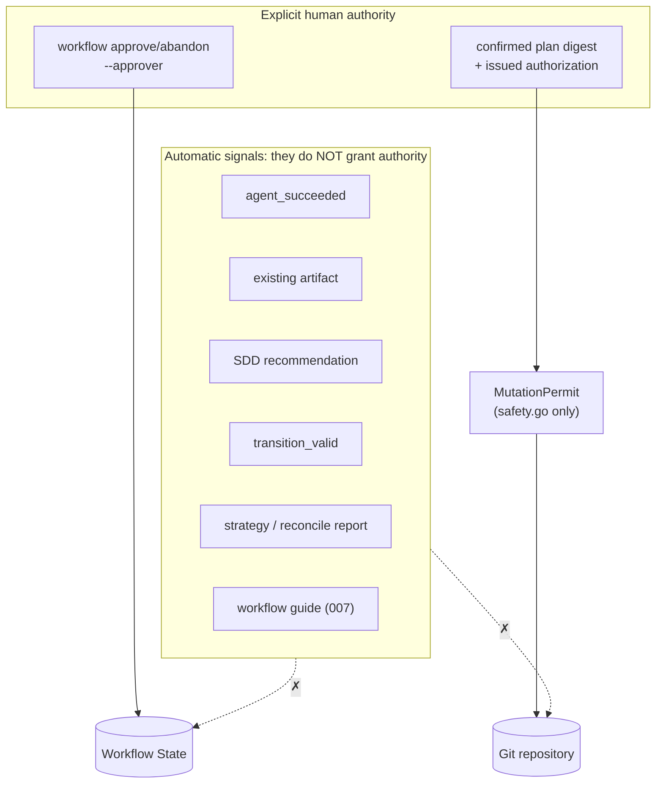

- **Human authority:** no automatic signal approves, transitions or mutates.
- **No shell or network:** Git is invoked with exact argv, without `sh -c`. It carries `protocol.allow=never`, `credential.helper=`, `core.sshCommand=false`, `GIT_TERMINAL_PROMPT=0` and `GIT_CONFIG_NOSYSTEM=1`.
- **No secrets in the output:** credentials from the user's configuration never appear in the output or the durable records. The initial commit's files are scanned for secrets before the first object is created.
- **Reports that are safe to paste:** the supplied values in the 004–007 text reports (identifier, approver, reason, target) go in double quotes, with `$`, backquotes and `!` escaped (004 FR-028, amendment 5). Pasting a report line into a shell runs or expands nothing it contains.
- **Literal paths:** non-literal paths and symbolic links are refused. Each component is opened with `O_NOFOLLOW` and its identity is checked again after the read.
- **Fail closed:** unsupported platforms or filesystems (tmpfs, remote, read-only) return a typed refusal and never an assumed partial success.

---

## Persistence

| Data | Location | Written by |
|---|---|---|
| Workflow State + Gate evidence | `specs/<feature-id>/workflow-state.json` | `gatestore` (atomic, with flock) |
| Project configuration | `<project>/.ai-dev/config.json` | `gitmanager` (no overwrite) |
| Project agents and roles (011) | `<project>/.ai-dev/agents.json` | `configstore` (atomic replacement) |
| Git authorizations, audit and locks | macOS: `~/Library/Application Support/ai-dev/state/git`<br/>Linux: `$XDG_STATE_HOME/ai-dev/git` or `~/.local/state/ai-dev/git` | `gitstore` |

```text
<state-root>/
├── attempts/<apply-id>/events/   ordered audit trail of each attempt
├── environment/                  nonexistent HOME and XDG for the sanitized Git environment
├── locks/by-device-inode/<key>/  apply lock by the project's physical identity
├── prepared/<random>/            private storage for the prepared index
└── projects/<project-digest>/
    ├── authorizations/<uuid>.json
    └── attempts/
```

---

## Development and quality

```sh
gofmt -l .                               # must list nothing
go vet ./...
go test ./...
go test -race -timeout 60m ./internal/gitstore ./internal/gitmanager ./internal/app ./cmd/ai-dev
```

The suite combines:
- **Unit tests** for each domain.
- **Fuzzing:** canonical encoding, plan decoding, attributes and Conventional Commits.
- **Integration with real Git**, in isolated temporary directories.
- **A failure matrix** (T110) that injects errors before and after each durable store step.
- **Race tests** (T111) for CAS, locks and the terminal close.
- **Structural tests:** package boundaries, the impossibility of bypassing the `MutationPermit`, and traceability of FR-001–192 and AC-001–032 to existing files and tests.
- **End-to-end tests** of the public CLI by subprocess.

The tests that apply real changes with Git require a **production filesystem** in the temporary directory: APFS on macOS, local ext4 on Linux. On tmpfs they are skipped, because the product correctly refuses it.

Verified evidence (2026-11-18), with the same code on both platforms:

| Platform | Git | Suite | `-race -count=3` |
|---|---|---|---|
| macOS 27 / APFS (arm64) | 2.54.0 | 2322 PASS, 0 FAIL | no races |
| Linux 7.1 / ext4 (loop in a VM, Fedora 44, non-root user) | 2.56.1 | 2322 PASS, 0 FAIL | no races |

It includes:
- **Crash recovery:** 92 real SIGKILLs, one before and one after each durable step.
- **Interruptions:** 168 real interruptions (SIGINT, SIGTERM and SIGHUP) and the forced exit on a second interruption.
- **I/O failures:** EIO, ENOSPC and EDQUOT injected at each step.
- **Hooks:** none runs with real Git, with a negative control that proves the hooks were active.
- **Git Flow:** `git-flow-next` validated with the real 2.1.0 tool.

The independent review is in [`specs/008-git-management/review.md`](specs/008-git-management/review.md). The CI workflow ([`.github/workflows/ci.yml`](.github/workflows/ci.yml)) passes on GitHub Actions on macOS (Homebrew Git) and Ubuntu (ext4): gofmt, vet, cross-builds, tests, `-race -count=3` and fuzzing. The `static-analysis` job runs govulncheck and staticcheck, and every action is pinned by commit SHA.

### Third-party dependencies

Since Feature 012 the binary depends on Bubble Tea v2 and Lip Gloss v2 (22 modules in total, all under the MIT or BSD license). Until then it used only the standard library.

- **Pinned versions:** `go.mod` and `go.sum` pin each module with its checksum, and `go mod verify` must pass.
- **14-day rule:** the newest version published at least 14 days before the date it is added or updated is used. A version is never bumped implicitly: `go mod tidy` may try to, so every update is reviewed in the `go.mod` diff.
- **Vulnerabilities:** govulncheck runs in CI and a reachable vulnerability fails the job.
- **Licenses:** only MIT, BSD or Apache-2.0, checked in each module's LICENSE when it is added. The list with dates and licenses is in [`specs/012-terminal-cockpit/tasks.md`](specs/012-terminal-cockpit/tasks.md).
- **Boundary:** only `internal/cockpit` imports these libraries, and a boundary test stops it from importing domain packages, `os/exec`, `net` or `syscall`, and from calling functions that write.

---

## Engineering process

The project follows **Spec Kit** and a [constitution](.specify/memory/constitution.md) with nine principles:

1. Specification First
2. Architecture Before Framework
3. Simplicity / YAGNI
4. Testable by Design
5. Security by Design
6. Observability by Design
7. Reproducibility and Automation
8. AI-Assisted Engineering
9. Human Authority

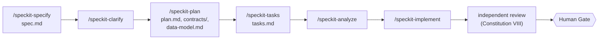

An agent never records a human approval on a person's behalf. Design deviations are noted as "proposed, pending human approval" in `tasks.md` and in `contracts/` until the maintainer approves them. In Feature 008, the maintainer delegated those decisions on 2026-11-18, so they were recorded as "accepted under delegation" after the independent review, never as an individual approval of theirs.

---

## Known limitations

- **Platforms:** only macOS (APFS) and Linux (local ext4) are production filesystems for Git Management. Native Windows is not supported; on Windows, use WSL2 with the project on the Linux filesystem. Use under WSL2 has no evidence of its own: it relies on the Linux/ext4 evidence.
- **Guide templates (007):** guaranteed only for POSIX shells (sh, dash, bash and zsh, with the tested options). fish and PowerShell are not covered.
- **Linux evidence:** obtained on loop-mounted ext4 inside a VM, not on a native Linux host.
- **Minimum Git version (2.45), resolved:** the `git-minimum` CI job builds Git 2.45.0 on the runner, from the official tarball with its SHA-256 pinned, and runs the real-Git suites with it (VER-01, T132). It passed for the first time (job 136054532762), so the minimum version is verified with real Git.
- **Residual recovery window (REC-06):** if the process dies after creating the commit and before installing the index, recovery uses Git's own commands (`git read-tree HEAD` or deleting `.git/index.lock`).
- **Orphaned claims (REC-07):** an authorization whose claim was orphaned by a crash before the intent is not reassigned; a new one must be issued.
- **SIGKILL:** cannot be deferred; it is recovered through the crash path.
- **`-` instruction in Codex CLI (002, amendment 1):** if the instruction is exactly `-`, Codex CLI reads the prompt from stdin instead of receiving `-`.
- **Power loss (DUR-01):** not simulated at the block level (T134, closed as declined by the maintainer). The order of fsync and directory syncs is covered by failure injection at each step and by SIGKILL at each durable step.
- **Out of scope by design:**
  - agent authentication;
  - automatic selection, retries or chaining of agents (007's autonomous mode is deferred);
  - background orchestration;
  - remote Git operations (push, fetch);
  - commits beyond the initial one;
  - in the cockpit (012): execution history, autonomous sessions, Git status, diff, push or merge, configurable themes and keys, and Neovim integration.

---

## License

ai-dev is distributed under the [Apache License 2.0](LICENSE).

To contribute, see [CONTRIBUTING.md](CONTRIBUTING.md). Vulnerabilities are reported privately, as [SECURITY.md](SECURITY.md) describes.
